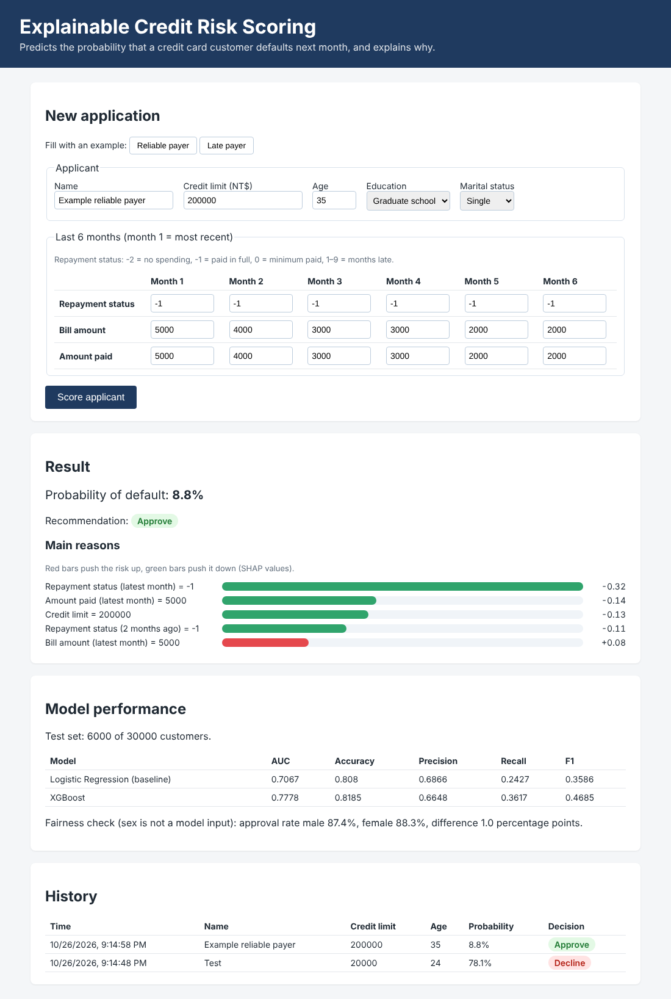

# Explainable Credit Risk Scoring Platform

Final Year Project prototype (BSc Computer Science, University of Surrey).

A web application that predicts the probability that a credit card customer will default next month,
explains each prediction with SHAP values, and audits the model for fairness between groups.



## Architecture

```
Browser (HTML/CSS/JavaScript)
        │  REST /api/...
        ▼
Java Spring Boot backend  ── JPA ──►  H2 SQL database (saved applications)
  backend/                 :8080
        │  REST /predict
        ▼
Python model service (FastAPI + XGBoost)
  ml-service/              :8000
```

- **ml-service/** (Python): downloads the data, trains the models, serves predictions and explanations.
- **backend/** (Java 17, Spring Boot 3): the main application. Validates input, calls the model service,
  stores every decision in the database, serves the web page.

## Dataset

[UCI Default of Credit Card Clients](https://archive.ics.uci.edu/dataset/350/default+of+credit+card+clients)
(Yeh & Lien, 2009). 30,000 customers in Taiwan, 2005; 22.1% defaulted. Licence CC BY 4.0.
`SEX` is excluded from the model inputs and only used for the fairness audit.

## Current results (20% held-out test set, 6,000 customers)

| Model | AUC | Accuracy | Precision | Recall | F1 |
| --- | --- | --- | --- | --- | --- |
| Logistic Regression (baseline) | 0.707 | 0.808 | 0.687 | 0.243 | 0.359 |
| XGBoost | 0.778 | 0.819 | 0.665 | 0.362 | 0.469 |

Fairness: approval rate 87.4% (male) vs 88.3% (female), a difference of 1.0 percentage point.

## How to run

You need **Python 3.10+**, **Java 17+** and **Maven** (IntelliJ IDEA includes Maven).

### 1. Model service (terminal 1)

```bash
cd ml-service
python -m venv .venv
# Windows: .venv\Scripts\activate     macOS/Linux: source .venv/bin/activate
pip install -r requirements.txt
python download_data.py     # downloads the dataset into data/
python train.py             # trains the models, writes model/ and prints the results
python -m pytest            # 4 tests
uvicorn app:app --port 8000
```

Open http://localhost:8000/docs to try the API directly.

### 2. Backend + web page (terminal 2)

```bash
cd backend
mvn spring-boot:run         # or run CreditRiskApplication in IntelliJ
mvn test                    # 2 tests (the model service is mocked)
```

Open http://localhost:8080, click **Reliable payer** or **Late payer**, then **Score applicant**.

The database console is at http://localhost:8080/h2-console
(JDBC URL `jdbc:h2:file:./data/creditrisk`, user `sa`, empty password). Try
`SELECT applicant_name, probability_of_default, decision FROM loan_application;`

## API

| Method | Path | Service | Purpose |
| --- | --- | --- | --- |
| POST | `/api/applications` | backend | Score an applicant and save the result |
| GET | `/api/applications` | backend | All saved applications, newest first |
| GET | `/api/model-metrics` | backend | Evaluation and fairness results |
| POST | `/predict` | ml-service | Probability of default + top 5 SHAP factors |
| GET | `/metrics` | ml-service | Contents of `model/metrics.json` |

## Decision rule

| Probability of default | Recommendation |
| --- | --- |
| below 30% | Approve |
| 30% to 50% | Manual review |
| 50% or more | Decline |
